# Digital Scale – PCB & Firmware

A battery-powered electronic scale designed from scratch: **component selection, schematic, PCB layout, assembly, bench measurements and firmware** for an NXP **LPC804** (Arm Cortex-M0+) microcontroller.

<p align="center">
  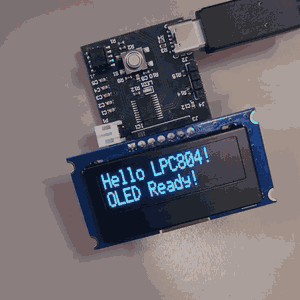
  &nbsp;
  
</p>

> hepia (HES-SO Geneva) · Embedded Systems Project · 2025 · Solo project
> 📄 [Report (French, 44 pages)](docs/report-fr.pdf) · [Slides (French)](docs/slides-fr.pdf) · 🎥 [Full demo video](docs/demo.mp4)

## Specifications

The assignment: a complete, compact (≤ 3 × 3 cm) battery-powered embedded system with a microcontroller, a JTAG/SWD debug connector, a serial bus (I²C, SPI or UART), a digital sensor and some user feedback. I chose to build a scale that shows the weight on an OLED display.

## Hardware

Designed in **Altium Designer** – a 2-layer board, manufactured, then assembled and tested by hand.

| Block | Part | Role |
|---|---|---|
| Microcontroller | NXP **LPC804** (Cortex-M0+) | two I²C buses, SWD, button and LED GPIOs |
| Force sensor | **FX29** load cell (14-bit, I²C) | weight measurement |
| Display | **OLED 2 × 16** characters (US2066, I²C) | user interface |
| Battery charger | Microchip **MCP73831-2ACI** | single-cell Li-Ion / Li-Po charging from USB-C, 4.2 V |
| Voltage detector | ROHM **BD5330G** | shuts the regulator down when the battery is too low |
| Regulator | Analog Devices **LTC3127** buck-boost | 3.3 V rail from the battery, Burst Mode for low quiescent current |
| Connectors | USB-C, SWD, sensor and display headers, battery | |

| Microcontroller | 3.3 V buck-boost |
|:---:|:---:|
| 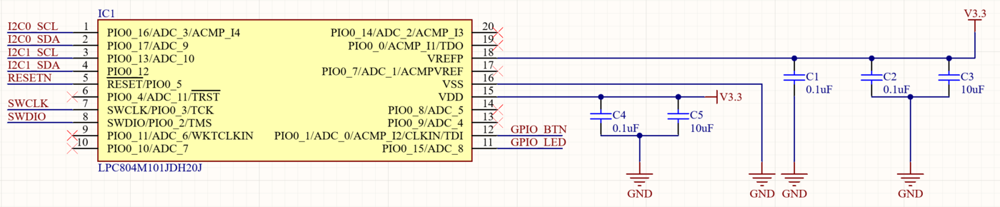 | 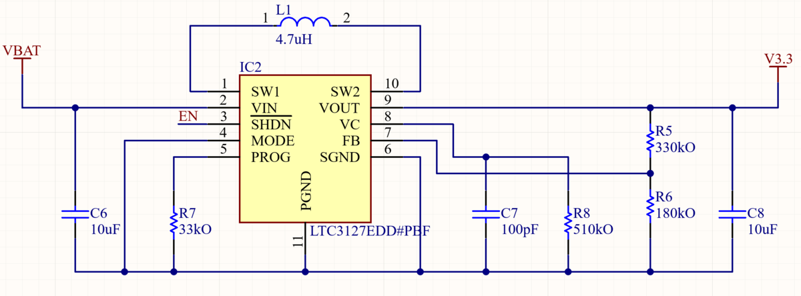 |
| **Battery charger** | **Voltage detector** |
| 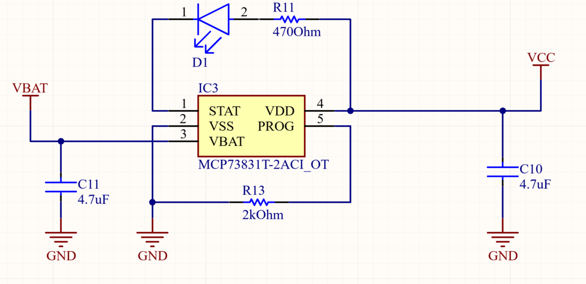 | 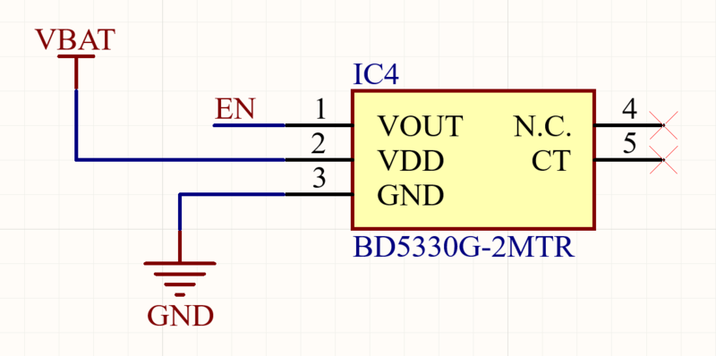 |
| **Force sensor connector (I²C)** | **Display connector (I²C)** |
| 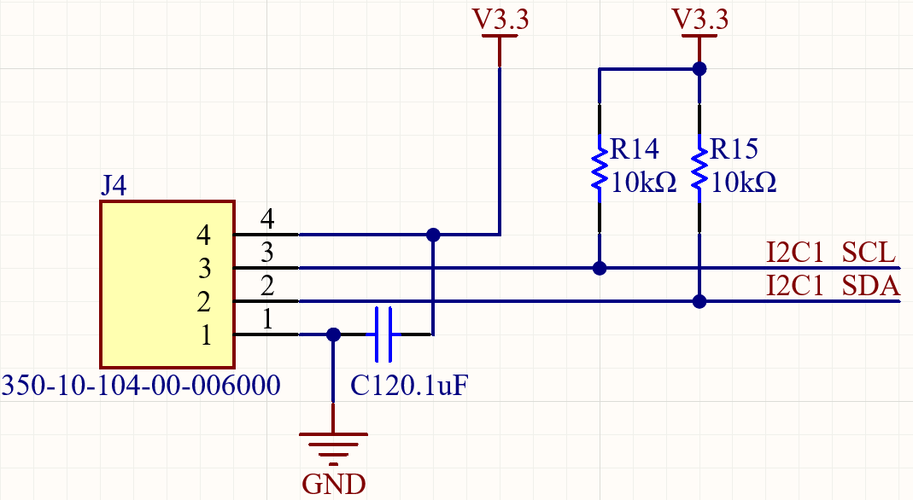 | 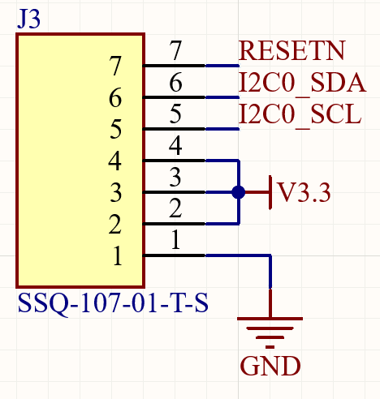 |

| Top layer | Bottom layer | Assembled board |
|:---:|:---:|:---:|
| 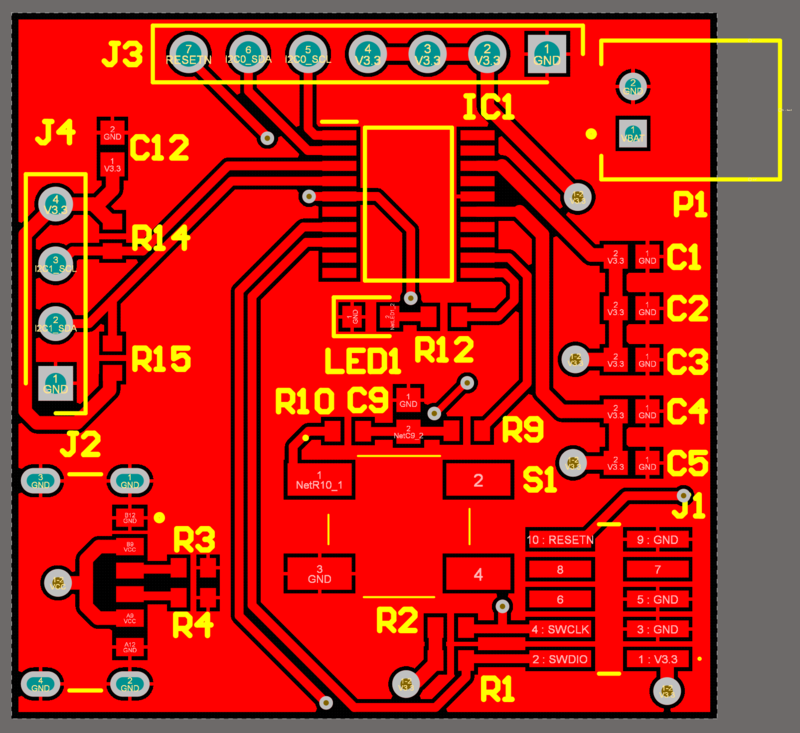 | 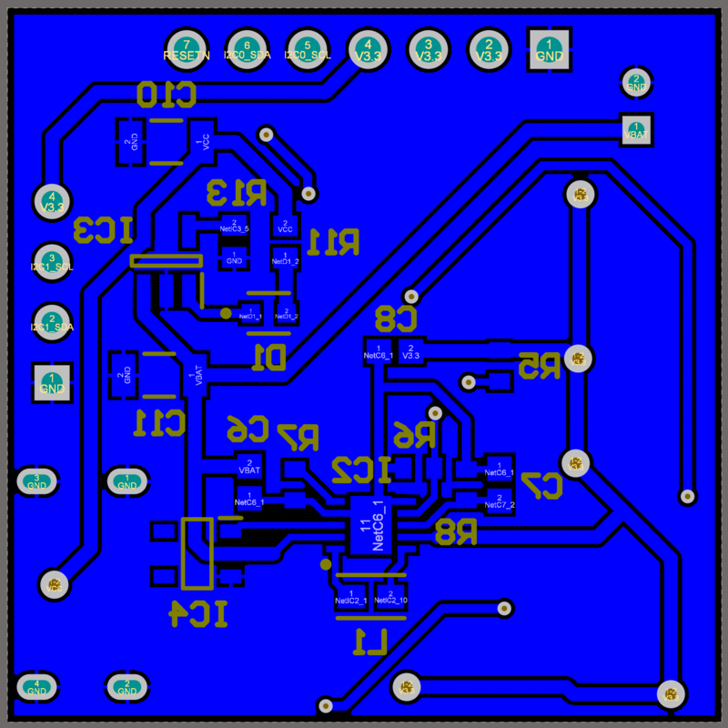 | 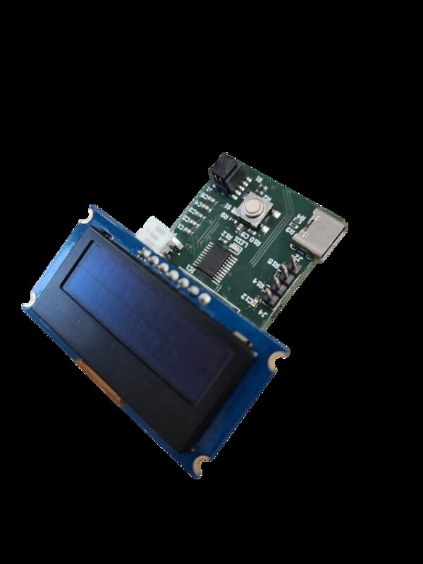 |

### Measurements

- **Battery charging**: charging starts above 2.8 V and stops at 4.2 V; the board itself uses only about 8 % of the USB input current.
- **3.3 V rail on battery**: well regulated over the whole battery range, and only enabled above 3 V to protect the battery; under a 500 mA load it drops to about 3.0 V for a 3.4–3.6 V battery.
- **3.3 V rail on USB only**: 0.6 V peak-to-peak ripple (about 10 %) – most likely an unsuitable output capacitor, identified as the first fix for a next revision.

<p align="center">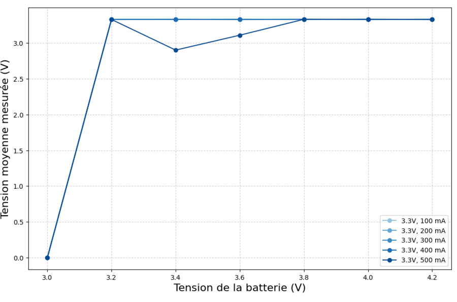</p>

## Firmware

MCUXpresso project for the LPC804, flashed and debugged over SWD with an LPC-Link2. The application code is in [`firmware/source/`](firmware/source):

- `screen.c` – I²C driver for the US2066 OLED display (init sequence, cursor, strings, clear)
- `fx29.c` – I²C driver for the FX29 load cell (raw 14-bit reading, tare, conversion to force)
- `scale_project.c` – non-blocking main loop (10 ms tick): LED blinking every second, button handling, display updates

> **Status:** the load cell was not delivered in time for the end of the project. Its driver is written but could not be tested on the board, so the demo firmware shows a **random value** on each button press instead of a real weight – it validates the board, the display, the button and the LED.

## Repository structure

```
├── hardware/       Altium project: schematic, PCB, libraries, BOM, PDF export
│   └── Project Outputs for scale_project/   Gerber and drill files, BOM (CSV)
├── firmware/       MCUXpresso project – source/ is the application, the rest is the NXP SDK
├── measurements/   Python scripts with the measured data, used to plot the report figures
└── docs/           report and slides (PDF), demo, photos, schematics, layout and measurement figures
```

## Tech

Altium Designer · PCB design · NXP LPC804 (Arm Cortex-M0+) · C · MCUXpresso · I²C · SWD · power electronics (charger, buck-boost) · Python / Matplotlib

## License

My code and design files are released under the [MIT license](LICENSE).
The NXP MCUXpresso SDK files in `firmware/` (CMSIS, device, drivers, board, utilities, startup) keep their own licenses (BSD-3-Clause / Apache-2.0).
