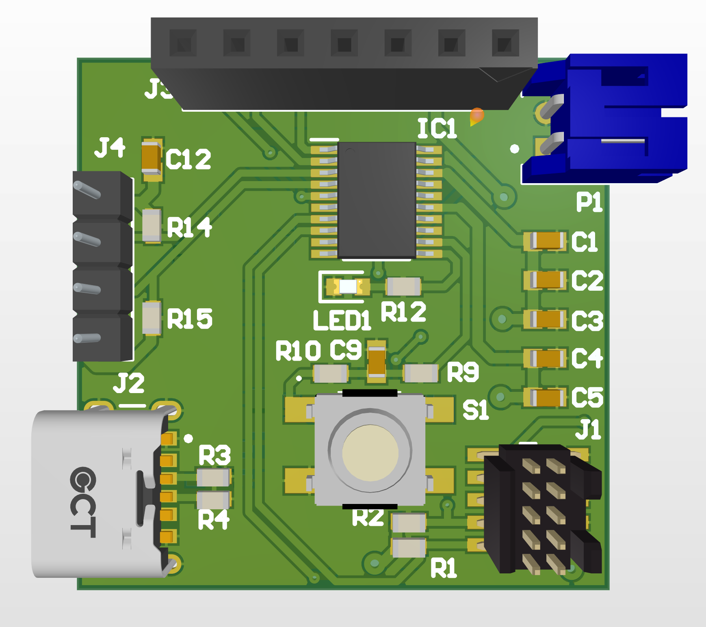
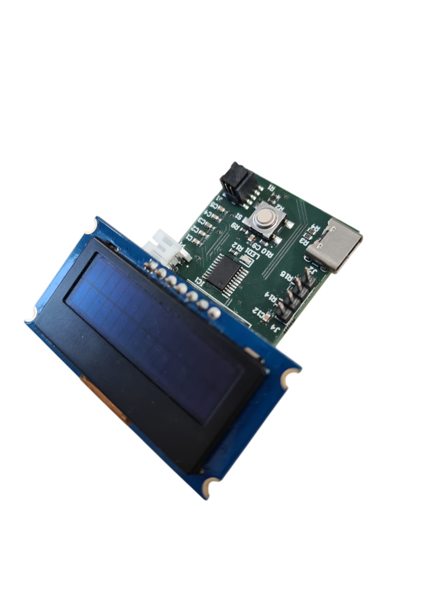

# Kitchen Scale – PCB & Firmware

A battery-powered electronic scale designed from scratch: **schematic, PCB layout, assembly and firmware** – hepia, Embedded Systems project, 2025.

   

🎥 Demo: [`docs/demo.mp4`](docs/demo.mp4) · 📄 Report (FR): [`report/report.pdf`](report/report.pdf) · Slides: [`docs/slides.pdf`](docs/slides.pdf)

## Hardware (Altium Designer)

- MCU **NXP LPC804** (Arm Cortex-M0+)
- **FX29** load cell (force sensor) read over I2C
- **OLED 2×16** character display (I2C)
- Li-Po battery with **MCP73831** charger, **LTC3127** buck-boost regulator and voltage supervisor
- USB-C power / charging, SWD debug connector, push-buttons and LED
- Board manufactured by Eurocircuits, assembled and tested by hand (charge / discharge measurements in the report)

## Firmware (MCUXpresso, C)

- I2C drivers for the OLED display and the force sensor
- Tare, weight display and button / LED handling

## Layout

| Folder | Content |
|---|---|
| `hardware/` | Altium project: schematic, PCB, libraries, BOM, Gerber outputs |
| `firmware/` | MCUXpresso project (`source/` holds the application code, the rest is the NXP SDK) |
| `report/` | Report sources (Typst), figures and measurement scripts |
| `docs/` | Slides, demo video, photos |

## Tech

Altium Designer · PCB design · NXP LPC804 · C · MCUXpresso · I2C · Typst · Python
